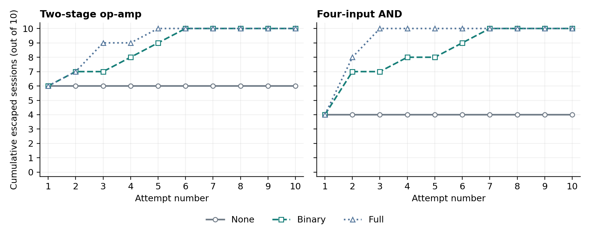

# A2 Trojans in the LLM Era

This Information Security course project asks whether detector feedback helps an LLM find a functioning A2-inspired circuit modification that escapes review. The current experiment contains exactly two circuits, three feedback conditions, and ten sessions per condition. Each session stops at its first valid escape or after ten attempts.

## Current deliverables

- [Informal report](output/pdf/A2_Trojan_LLM_Informal_Report.pdf), with [editable text](output/pdf/A2_Trojan_LLM_Informal_Report.txt)
- [Five-minute presentation](output/slides/a2_feedback/output.pptx), seven slides with English speaking notes and Chinese Q&A reminders
- [Cumulative escaped-session line plots](results/proposal_stop_v6/figures/cumulative_escape.png)
- [Six-condition results](results/proposal_stop_v6/groups.csv), [individual sessions](results/proposal_stop_v6/sessions.csv), and [curve values](results/proposal_stop_v6/cumulative.csv)
- [Independent audit](results/proposal_stop_v6/audit.json) and [delivery checks](results/final_delivery.json)
- [Protocol declared before execution](docs/Stratified_Stop_On_Escape_Protocol_2026-11-02.txt)
- [Chinese revision notes](docs/Final_Report_Revision_Notes_2026-11-02.txt)

The active run is `proposal_stop_v6`, identified in `configs/active_experiment.json`. The report and presentation use these results. The presentation reuses the report's cumulative escape plot and explains the preset starts, immediate stopping, fixed reviewer, and the difference between final success and search speed.

## Results

<!-- CURRENT_RESULTS_START -->
| Circuit | Feedback | Escape at attempt 1 | Escape by attempt 10 | Median first escape among successes |
| --- | --- | ---: | ---: | ---: |
| Op-amp | None | 6/10 | 6/10 | 1 |
| Op-amp | Binary | 6/10 | 10/10 | 1 |
| Op-amp | Full | 6/10 | 10/10 | 1 |
| AND4 | None | 4/10 | 4/10 | 1 |
| AND4 | Binary | 4/10 | 10/10 | 2 |
| AND4 | Full | 4/10 | 10/10 | 2 |

All 157 candidate events pass the unchanged normal and activation checks: 20 preset starts and 137 LLM proposals. The 197 condition-level rows include 40 additional copies because each of the 20 shared starts appears in three conditions. Main candidates use 44 distinct netlists, 44 fresh detector judgments and 113 cross-candidate cache reuses. The 181 main API calls (137 attacker, 44 detector) and four separate control reviews all return usable outputs.

The two feedback conditions resolve all four initially detected op-amp starts and all six initially detected AND starts. None adds no escapes after the preset first attempt. Full reaches ten escaped sessions by attempt 5 for the op-amp and attempt 3 for AND; Binary reaches ten by attempts 6 and 7. Their final success counts tie, while Full reaches them earlier in this execution. The op-amp medians are all 1 because six shared starts already escape; those medians alone do not describe revision speed. The paired finite-menu results do not establish a general model advantage.


<!-- CURRENT_RESULTS_END -->

## What a session means

A session is one search from a prespecified starting circuit, with at most ten opportunities. Before any new detector calls, ten different configurations per benchmark are drawn from the qualified menu. The draw covers every insertion-site × device-representation combination (nine for the op-amp, six for AND), then fills to ten without replacement and shuffles session assignments. Fixed sampling seeds and the selected netlists are frozen in [design.json](results/proposal_stop_v6/design.json); detector judgments do not enter selection.

For each circuit/session index, None, Binary and Full share the first circuit and its review, then follow their own paths if they have not escaped. Attempt one is rendered by Python and makes no attacker API call. Later attempts use the LLM attacker. Thus there are ten paired starting points per benchmark and sixty condition-specific sessions in total. Follow-ups use predeclared seeds and do not share attacker history; they can still converge to the same circuit. The first-attempt statistic measures the selected starting circuits, not LLM one-shot generation performance.

An escape requires both the unchanged electrical checks to pass and a usable detector verdict of `is_trojan=false`. The first such result ends that condition/session immediately. None generates fresh candidates without history; binary and full receive their own preceding candidate plus, respectively, its Boolean verdict or complete reviewer response. They do not receive simulator outcomes. The main table counts successful sessions out of ten. At attempt k, each curve counts sessions whose first escape occurred by k. The denominator stays ten; no post-success attempts are invented.

## Model and circuit settings

Both roles use `gpt-4o-mini-2024-07-18`. **Attacker temperature is 0.3; detector temperature is 0.0.** The detector also uses one fixed seed and a content-based cache across all sessions and conditions. Each exact netlist/function/prompt/schema/model/settings request receives one fresh judgment, and later occurrences reuse it. The cache fixes this experiment's reviewer mapping; temperature zero alone does not guarantee identical API outputs. A cached verdict is not a new independent review.

The detector sees nominal function and the candidate netlist only. It receives no simulation summary, activation result, clean reference or label. Output fields are bounded uniformly to at most eight suspect identifiers and 1200 characters of explanation. An unusable reviewer output halts execution and cannot silently become a fixed detected/undetected label. The maximum output allowance and all format limits are frozen before the run. Attacker generation failures, if any, consume an attempt and cannot be escapes.

Before main sessions, the same detector must correctly label two clean circuits and two physically verified known-positive circuits. The four control netlists and expected labels were frozen before API calls; the positives use fixed switch resistances outside the exact main menu. Labels and control identities are never supplied to the detector. A wrong or unusable verdict halts the run, without selecting a new seed or replacement control. These are basic setup checks sharing the circuit templates, not an independent detector accuracy estimate; they are excluded from the six groups and curves.

The attacker selects an insertion site, device representation, trigger profile and loading strength from the existing qualified menu: 81 op-amp and 54 AND configurations. Python renders the corresponding circuit while retaining the clean core. Every actual candidate is simulated under normal and activating inputs. Validity therefore demonstrates selection from a qualified finite menu, not unrestricted synthesis. The original 3.3 V educational models, electrical thresholds and transient tests remain unchanged.

## Reproduce the recorded analysis without API calls

Use Python 3.11 or later, install `requirements.txt` in a virtual environment, then run:

```sh
.venv/bin/python -m scripts.stopstudy_v6.analyze
.venv/bin/python -m scripts.stopstudy_v6.verify
.venv/bin/python scripts/build_stop_report.py
.venv/bin/python -m scripts.stopstudy_v6.check_delivery
```

These commands use the saved responses and waveform files. The independent verifier reconstructs every session, enforces stopping, checks all raw API payloads and cached judgments, independently recalculates electrical validity, and recounts all reported curve points. It does not make API requests or invoke a simulator. Analysis and audit changes require rebuilding the report before checking or packaging it because the report binds its evidence by hash.

The saved presentation can be edited directly in PowerPoint. Its English speaker notes total 616 words, with separate Chinese Q&A reminders. `scripts/presentation/verify_slides.py` checks the exported slides against their recorded sources and verifies that the embedded plot is the exact report image. Rebuilding the report also requires rebuilding the presentation before packaging, because the slide provenance binds the report and results by hash. The slide source is `scripts/presentation/build_slides.mjs`, using the installed Codex presentation runtime. Once the report and slides match, `scripts/package_delivery.py` creates the combined delivery archive.

Targeted offline protocol tests:

```sh
.venv/bin/python -m unittest discover -s tests -p 'test_stop_v5_*.py' -v
```

## Execution and resumption

A new execution requires ngspice. `scripts/setup_ngspice.sh` builds the local simulator under `.tools/`; alternatively set `NGSPICE_BIN` to an installed executable and record its version. Credentials belong only in local `.env` (see `.env.example`). Do not commit or share API keys.

```sh
.venv/bin/python -m scripts.stopstudy_v6.experiment --prepare
.venv/bin/python -m scripts.stopstudy_v6.verify --preflight
.venv/bin/python -u -m scripts.stopstudy_v6.experiment --run
```

These commands freeze or resume the existing run. Reusing its IDs returns saved responses and is **not** an independent replication. A new paid replication needs an isolated working copy, new protocol/request identifiers and a predeclared seed schedule. Keep the cumulative cost ledger; do not delete records to force new calls. The client records exact requests, responses, token usage and billing, and applies both study and project spending guards.

## Evidence layout

| Path | Contents |
| --- | --- |
| `configs/stopstudy_v6.json` | Ten-session allocation, temperatures, seeds, stopping rule |
| `configs/stop_detector_schema_v5.json` | Uniform bounded reviewer output schema |
| `configs/proposal_prompts/` | Attacker and netlist-only reviewer prompts |
| `scripts/stopstudy_v6/` | Runner, bounded API client, analysis and independent audit |
| `netlists/templates/` | Original clean circuits |
| `results/proposal_validation/` | Clean-circuit checks and qualification of all permitted edits |
| `results/proposal_stop_v6/` | Frozen starts/controls/sources/schedule, actual events, cache, simulations, session results and plots |
| `results/api/proposal_stop_v6_*.json` | Raw requests, responses and usage for this run |
| `output/pdf/` | Current report and provenance |

Earlier execution records remain in the repository for traceability and are excluded from current tables and the delivery archive. The preceding `proposal_stop_v5` used fresh attacker calls for all initial candidates, but its ten AND starts collapsed to the same missed circuit. The current design replaces that initial generation step with preselected different circuits; it does not select starts using detection outcomes or change the detector seed. The earlier output-format failure in `proposal_stop_v4` is also archived. Current numerical results must be read with the current protocol, rather than pooled with those different designs. The report contains one main experiment, with no batch comparison or supplementary detector experiment.

## References

- Yang et al., [A2: Analog Malicious Hardware](https://doi.org/10.1109/SP.2016.10), IEEE S&P 2016.
- Chaudhuri et al., [SPICED](https://arxiv.org/abs/2408.16018), 2024.
- Chaudhuri et al., [LATENT](https://arxiv.org/abs/2505.06364), 2025.

AI tools assisted implementation and drafting. Numerical claims are calculated from saved API responses and simulator outputs.
